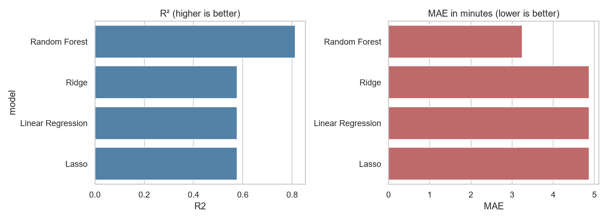
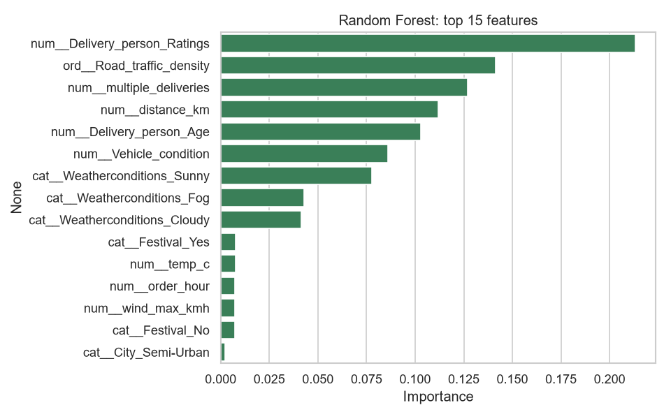
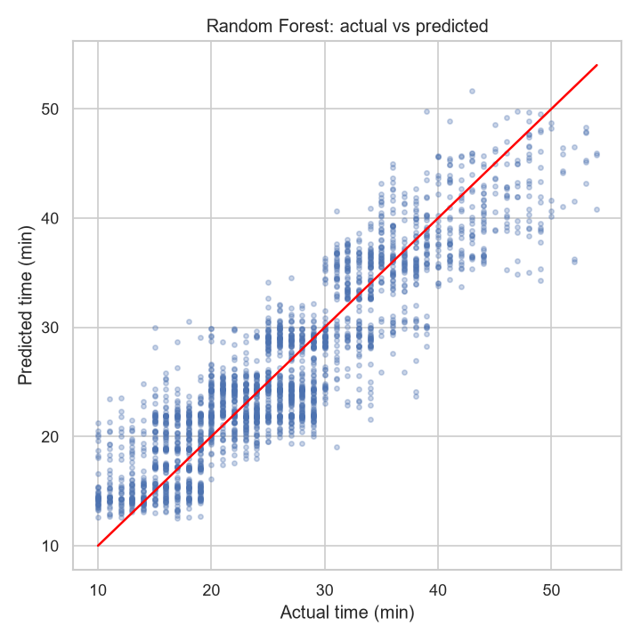

# Predicting Food Delivery Time in Indian Cities
### The impact of weather, traffic and festivals

Online food delivery platforms (Zomato, Swiggy) promise fast delivery, but actual
delivery times vary widely with weather, traffic, festival rush and rider factors.
This project builds regression models that predict **delivery time in minutes**.

**Objectives**
1. Clean and combine messy real-world data from multiple food-delivery and weather sources.
2. Analyse and visualise which factors affect delivery time most.
3. Build regression models that predict delivery time from order, rider, weather and traffic details.
4. Compare models (Linear, Ridge, Lasso, Random Forest) using R², MAE and RMSE.

---

## Architecture

```
 RAW SOURCES                 CLEANING                    FEATURES                     MODELING                    OUTPUT
 ───────────                 ────────                    ────────                     ────────                    ──────
 food_delivery/train.csv ──► clean_orders() ──┐
   (45,593 orders,                            │
    Feb–Apr 2022)                             ├─► join on (city, date, hour) ─► build_features() ─► 80/20 split
                                              │                                      │                  │
 weather/*.csv (Open-Meteo) ► merge_weather() ┘                                      │                  ├─► Linear Regression
   2 exports, GMT + IST       → weather_merged.csv                                   │                  ├─► Ridge  (GridSearch α)
                                                                                     │                  ├─► Lasso  (GridSearch α)
 Indian holiday calendar ───────────────────────────────► festival flags ────────────┘                  └─► Random Forest (GridSearch)
                                                                                                                │
 zomato/zomato.csv ────────► EDA only (Bangalore restaurant cost / rating context)              5-fold CV · R² · MAE · RMSE
                                                                                                                │
                                                                                     comparison table · residual plots · feature importance
```

## Repository layout

```
├── data/
│   ├── raw/
│   │   ├── food_delivery/        train.csv, test.csv, Sample_Submission.csv
│   │   ├── weather/              Open-Meteo exports (Feb–Jul 2022 GMT; Jul 2022–2026 IST)
│   │   └── zomato/               zomato.csv  (not committed – 548 MB, see below)
│   └── processed/
│       ├── weather_merged.csv    output of src/merge_weather.py
│       ├── orders_clean.csv      all cleaned orders from 19 Feb 2022 (38,351 rows)
│       └── model_data.csv        cleaned orders with weather (12,645 rows) – modeling input
├── notebooks/
│   ├── 01_cleaning_merging.ipynb
│   ├── 02_eda.ipynb
│   └── 03_modeling.ipynb
├── src/
│   ├── merge_weather.py          merges both weather exports into one tidy table
│   └── clean_orders.py           cleans orders, engineers features, joins weather
├── reports/figures/
└── requirements.txt
```

## Data sources

| Source | Content | Use |
|---|---|---|
| [Food Delivery Dataset (Kaggle)](https://www.kaggle.com/datasets/gauravmalik26/food-delivery-dataset) | Rider age/rating, restaurant & customer lat/long, order/pickup time, weather, traffic, festival, city, vehicle, `Time_taken(min)` | Main dataset & target |
| [Open-Meteo Historical API](https://open-meteo.com/en/docs/historical-weather-api) | Hourly temperature; daily precipitation, rain, min/max temp, max wind for Bangalore, Mumbai, Delhi, Pune, Chennai, Kolkata | Numeric weather features |
| [Zomato Bangalore Restaurants (Kaggle)](https://www.kaggle.com/datasets/himanshupoddar/zomato-bangalore-restaurants) | Restaurant cost, rating, cuisine, area | EDA context only |

`zomato.csv` is too large for GitHub – download it from Kaggle into `data/raw/zomato/`.

### Weather merge (`src/merge_weather.py`)
The two Open-Meteo exports differ in ways that silently break a naive concat:
- **Timezone** – Feb–Jul file is GMT, the other is IST → shifted +5:30.
- **location_id order** – Chennai/Kolkata IDs are swapped between files → cities matched by coordinates.
- **Overlap** – 1–2 Jul 2022 appears in both → IST export kept.
- **Missing column** – `wind_gusts_10m_max` absent in the Feb–Jul export → NaN.

Result: 229,650 rows, one per city-hour, continuous from 19 Feb 2022 to 2 Jul 2026.

## Plan

**1 · Cleaning** – strip trailing spaces; `"NaN "` → NaN; remove `"conditions "` prefix in weather and
`"(min) "` prefix in target; fix `"Metropolitian"`; parse `DD-MM-YYYY` dates; fix zero/negative coordinates;
derive **city** from `Delivery_person_ID` prefix (`BANGRES…` → Bangalore); impute (median numeric, mode categorical).

**2 · Features** – Haversine `distance_km`; `prep_time_min` (pickup − order); `order_hour`, `day_of_week`,
`is_weekend`, `is_peak`; weather `temp_c`, `rain_mm_day`, `wind_max_kmh`; ordinal traffic (Low<Medium<High<Jam);
one-hot weather / vehicle / order type / city type; StandardScaler.

**3 · EDA** – target distribution; time by traffic, weather, festival, city type, vehicle; distance vs time;
correlation heatmap; time by hour of day; rider rating vs time; Zomato cost/rating by Bangalore area.

**4 · Modeling** – 80/20 split of `train.csv` (Kaggle `test.csv` has no labels); sklearn `Pipeline`
(preprocessor → model) to avoid leakage; Linear, Ridge, Lasso, Random Forest with `GridSearchCV`.

**5 · Evaluation** – R², MAE, RMSE on hold-out + 5-fold CV mean ± std; actual-vs-predicted and residual plots;
RF feature importance vs Lasso coefficients.

## Cleaning results (`src/clean_orders.py`)
- Orders are kept from **19 Feb 2022**, the first weather date. The orders have no dates between
  19 and 28 Feb, so this drops exactly 11–18 Feb: 45,593 → **38,351** orders.
- 41 rider ratings of 6.0 (all with age 50, i.e. placeholder rows) → treated as missing.
- Festival calendar added: Maha Shivaratri (1 Mar), Holi (18 Mar), Ugadi/Gudi Padwa (2 Apr).
- Weather joined on (city, date, hour) → **12,645** orders in Bangalore, Mumbai, Chennai, Pune.

## EDA findings (`notebooks/02_eda.ipynb`)
| Factor | Effect on average delivery time |
|---|---|
| Festival | 25.8 → **45.4 min** (biggest single jump, but only 2 % of orders) |
| Multiple deliveries | 0 → 22.9 min, 3 → **47.5 min** |
| Traffic | Low 21.6 → **Jam 31.0 min** |
| Weather label | Sunny 22.0 vs Fog/Cloudy ≈ 28.7 min |
| Distance / rating / age | correlation +0.32 / −0.32 / +0.29 |

Little or no effect: order type, weekend, the 4 cities themselves, and Open-Meteo temperature/rain/wind (|r| < 0.03).
Effects are step-like and interact (Cloudy/Fog + Jam ≈ 36.7 min, Sunny ≈ 22 min at every traffic level).

## Results (`notebooks/03_modeling.ipynb`)
80/20 split (10,116 train / 2,529 test), preprocessing inside a `Pipeline` to avoid leakage, hyper-parameters
chosen with 5-fold `GridSearchCV` on the training set.

| Model | R² | MAE (min) | RMSE (min) | 5-fold CV R² |
|---|---|---|---|---|
| **Random Forest** (max_depth=10, 200 trees) | **0.813** | **3.25** | **4.04** | 0.806 ± 0.009 |
| Ridge (α=1) | 0.576 | 4.87 | 6.07 | 0.578 ± 0.008 |
| Linear Regression | 0.576 | 4.87 | 6.07 | 0.578 ± 0.008 |
| Lasso (α=0.001) | 0.576 | 4.87 | 6.07 | 0.578 ± 0.008 |



**Key findings**
- **Random Forest wins clearly.** Its predictions are off by about 3.2 min on average, against about 4.9 min for the linear models. The gap
  (0.23 R²) is about 25× the cross-validation spread, so it is not a lucky split. Trees capture the step-like effects and
  interactions the EDA found; straight lines cannot.
- **Ridge and Lasso match plain Linear Regression.** With about 10k rows and about 30 columns there is no overfitting for the penalty to fix,
  and GridSearch picked very weak penalties.
- **Most important factors** (RF importance): rider rating, traffic density, multiple deliveries, distance, rider age,
  which matches the EDA. Festival ranks low despite its +20 min effect because it affects only 2 % of orders.
- **Measured weather does not help.** Retraining the forest without Open-Meteo temperature/rain/wind gives R² 0.814 vs
  0.813 with them.
- Residuals are centred on 0 (mean +0.04 min), so the model is not biased up or down.

**Bonus: more data instead of real weather** (Section 9, `reports/more_data_comparison.csv`)

Same 2,529 test orders; training on all 12 cities (35,822 orders) without Open-Meteo columns:

| Setup | R² | MAE (min) | RMSE (min) |
|---|---|---|---|
| Linear: 4 cities + weather | 0.576 | 4.87 | 6.07 |
| RF: 4 cities + weather | 0.813 | 3.25 | 4.04 |
| Linear: 12 cities, no weather | 0.575 | 4.87 | 6.07 |
| **RF: 12 cities, no weather** (max_depth=15) | **0.825** | **3.15** | **3.90** |

5-fold CV on all 38,351 orders: R² 0.812 ± 0.003. Dropping two-thirds of the orders to add measured weather cost a
little accuracy and gained nothing. The gain from 3.5× more data is modest, so most of the remaining error comes from
information the dataset does not contain (restaurant workload, real routes), not from too few rows.




## Known limitations
**Data**
- **Synthetic coordinates.** Restaurant-to-customer offsets come in neat 0.01° steps with equal counts, so
  `distance_km` is a straight-line distance between generated points, not a road distance.
- **Short window.** Orders span only 36 days (1 Mar – 6 Apr 2022), with no monsoon or seasonal effects.
- **Rare groups.** Festival 250 orders (2 %), Semi-Urban 41, bicycle 20, which is too few to learn reliably.
- **Weather label vs real weather.** Labels such as "Sandstorms" appear evenly in every city and do not match
  measured weather; the label likely encodes slowness rather than actual conditions.
- **Missing drivers.** No restaurant workload, order size, restaurant identity or road incidents.
- Target is whole minutes between 10 and 54, so extreme delays are never seen.

**Trade-offs we made**
- **Data size for weather.** Weather exists for 6 cities; Delhi has no orders and all Kolkata orders fall on 11–18 Feb
  (before the weather data starts), so the modeling set keeps 4 cities: 12,645 of 38,351 cleaned orders (≈33 %).
- City is inferred from the rider ID prefix, and weather is one city-wide value per hour or day.
- **Rider rating** is the top predictor but is partly a *result* of past delivery speed. It is predictive, not causal.
- Wind gusts are missing for the whole order window and are not used; daily aggregates in the Feb–Jul export
  use GMT days.

## Setup
```bash
pip install -r requirements.txt
python src/merge_weather.py
python src/clean_orders.py
```
